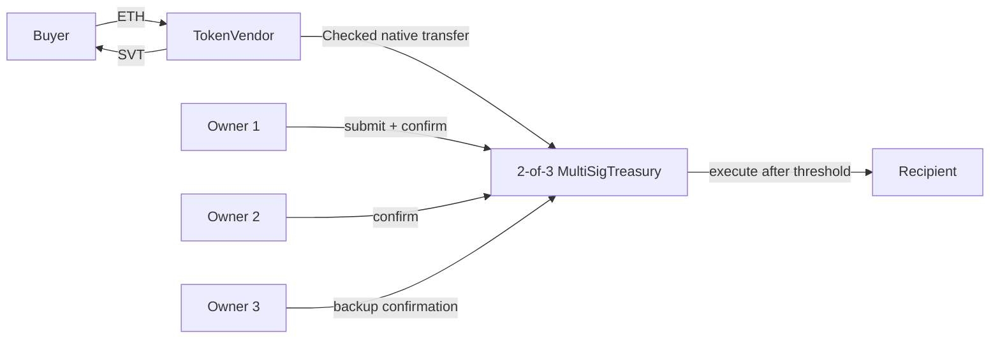

# SafeVendor

**Repository:** https://github.com/furina0508x-glitch/safevendor-cds528

SafeVendor is a fixed-price ERC-20 sale that sends every sale payment directly
to a 2-of-3 multisig treasury. A single treasury owner cannot move user funds.

This repository is the CDS528 group project submission. It targets Ethereum
Sepolia and uses worthless test assets only.

## Live Sepolia deployment

Network: [Sepolia](https://sepolia.etherscan.io) (`chainId: 11155111`)

| Contract | Address | Source verification |
|---|---|---|
| SafeVendorToken | [`0x69D7f801AA1EB37321B6F7C1843E380c76C4deeA`](https://sepolia.etherscan.io/address/0x69D7f801AA1EB37321B6F7C1843E380c76C4deeA#code) | [Verified](https://sepolia.etherscan.io/address/0x69D7f801AA1EB37321B6F7C1843E380c76C4deeA#code) |
| MultiSigTreasury | [`0x53C6F389B8773C9C74b275BCb2B55ba4C119F13d`](https://sepolia.etherscan.io/address/0x53C6F389B8773C9C74b275BCb2B55ba4C119F13d#code) | [Verified](https://sepolia.etherscan.io/address/0x53C6F389B8773C9C74b275BCb2B55ba4C119F13d#code) |
| TokenVendor | [`0x6030d8D8674f96F3e8BF9dCe5AF74b65247d519A`](https://sepolia.etherscan.io/address/0x6030d8D8674f96F3e8BF9dCe5AF74b65247d519A#code) | [Verified](https://sepolia.etherscan.io/address/0x6030d8D8674f96F3e8BF9dCe5AF74b65247d519A#code) |

Deployment evidence is stored in
[`deployments/sepolia.json`](deployments/sepolia.json).

### Live transaction evidence

| Action | Transaction |
|---|---|
| Deploy SVT | [`0x230cc3be...ab34a7`](https://sepolia.etherscan.io/tx/0x230cc3be5f5ead3886ce1ff5ccdc842cbe4831ce455db8ca9715cca849ab34a7) |
| Deploy Treasury | [`0xa1c8b8ab...dbad4e`](https://sepolia.etherscan.io/tx/0xa1c8b8abc284f6849720e9973048c1ad111610139ccbfcf161af242291dbad4e) |
| Deploy Vendor | [`0xfdf11edf...dfa8f7e`](https://sepolia.etherscan.io/tx/0xfdf11edf7d8f415c5635191f043155b69b456644599b438b074d50a11dfa8f7e) |
| Fund 1,000,000 SVT inventory | [`0xaf123d0d...59f73d6`](https://sepolia.etherscan.io/tx/0xaf123d0dfe586e4ba416a3161e5148efb225901cbd144dfc079061ed159f73d6) |
| Buy 100 SVT with 0.01 ETH | [`0xbe98f58b...a3da29a`](https://sepolia.etherscan.io/tx/0xbe98f58bb0fb55dba6283720c9a12fca8e8d545e36814cd3c66924ba9a3da29a) |
| Submit treasury proposal | [`0x019e15f6...5c11fa`](https://sepolia.etherscan.io/tx/0x019e15f677db6b42d5e641ee5a84f0c4b2f45b4f825d1657c77122fdcd5c11fa) |
| Second owner confirms | [`0xb573584d...5ef6fe`](https://sepolia.etherscan.io/tx/0xb573584d4eabc192fdb8fbfba55c290412f0ebf68cee1bcc1a353095cc5ef6fe) |
| Execute proposal | [`0xcefee4c9...f8775e`](https://sepolia.etherscan.io/tx/0xcefee4c9350b8007c146db0f5587ccf5be3424143509c1519762174f15f8775e) |

The demo bought 100 SVT for 0.01 ETH, routed the ETH directly to Treasury, and
executed a 0.001 ETH transfer after two distinct owners confirmed it.

## Architecture



### Contracts

| Contract | Responsibility | Key control |
|---|---|---|
| `SafeVendorToken` | Fixed-supply ERC-20 named SVT | No post-deployment mint authority |
| `TokenVendor` | Fixed-rate sale and direct ETH settlement | Immutable price and treasury |
| `MultiSigTreasury` | Shared custody and proposals | Fixed owners, 2-of-3 threshold |

### Sale mechanics

- Sale price: `0.0001 ETH` per `1 SVT`.
- Supply: `1,000,000 SVT`, minted once at deployment.
- Inventory: all SVT is transferred to the vendor after deployment.
- ETH settlement: the vendor sends sale proceeds to Treasury in the same
  transaction.
- Rounding: the buyer specifies `minTokensOut`; any integer remainder is
  refunded.
- Failure behavior: a failed treasury payment, refund, or token transfer reverts
  the complete purchase.

### Treasury mechanics

1. An owner submits a transaction. The submission counts as that owner's first
   confirmation.
2. A different owner confirms it.
3. Once two confirmations exist, an owner executes the transaction.
4. Execution marks the transaction before making the external call, using
   Checks-Effects-Interactions and `ReentrancyGuard`.

## Project structure

```text
contracts/           Solidity source and the reentrancy test receiver
scripts/             deployment, verification, wallet setup, and live demo scripts
test/                Hardhat unit and failure-path tests
frontend/            Vite + ethers.js operational dApp
deployments/         generated Sepolia address and transaction evidence
docs/                architecture, security, requirements, and demo material
report/              final report source and exported files
slides/              final presentation and rendering checks
outputs/             submission-ready copies for the user
```

## Setup

Requirements:

- Node.js 20 or newer
- `pnpm` through Corepack, or a compatible Node package manager
- A Sepolia RPC endpoint
- A test-only deployment wallet
- An Etherscan API key for command-line verification

```bash
corepack enable
pnpm install
pnpm compile
pnpm test
pnpm coverage
pnpm lint:sol
pnpm frontend:build
```

The current verification run produced:

- 17 passing tests
- 100% statement, function, and line coverage for production contracts
- 79.03% aggregate branch coverage
- Slither: no High or Medium findings; two intentional low-level `call` INFO
  findings

## Environment configuration

Copy `.env.example` to `.env` and set the values. Never commit `.env`.

```bash
SEPOLIA_RPC_URL=https://sepolia.infura.io/v3/<project-id>
PRIVATE_KEY=<test-only deployer key>
TREASURY_OWNERS=<owner1>,<owner2>,<owner3>
ETHERSCAN_API_KEY=<key>
```

`PRIVATE_KEY` must belong to a dedicated test wallet. The repository ignores
`.env`, wallet candidate files, and private key material.

## Deploy

```bash
pnpm deploy
```

The script performs these steps:

1. Validates the Sepolia chain ID.
2. Deploys `SafeVendorToken` with 1,000,000 SVT.
3. Deploys `MultiSigTreasury` with three distinct owners and threshold `2`.
4. Deploys `TokenVendor` with the token, treasury, and fixed price.
5. Transfers the complete token supply to the vendor.
6. Writes addresses, constructor arguments, and transaction hashes to
   `deployments/sepolia.json` and `frontend/src/deployment.json`.

Deployment order matters because Treasury has no setters and Vendor immutably
stores the Token and Treasury addresses.

## Verify

The live contracts are already verified using Etherscan's Standard JSON input.
To verify a fresh deployment from the command line:

```bash
pnpm verify
```

`pnpm verify` requires `ETHERSCAN_API_KEY`. The verification source is generated
from the Hardhat build info with Solidity `0.8.24`, optimizer enabled, and 200
runs.

## Frontend

```bash
pnpm frontend:dev
```

The dApp can:

- Read live vendor inventory and treasury balance.
- Quote a fixed-price purchase.
- Connect a Sepolia wallet and buy with slippage protection.
- Show treasury owners, threshold, and recent proposals.
- Submit, confirm, and execute treasury transfers from owner wallets.

Production build:

```bash
pnpm frontend:build
```

## Security summary

| Threat | Mitigation |
|---|---|
| Single-owner rug pull | Sale proceeds enter a 2-of-3 Treasury; Vendor has no seller withdrawal path |
| Reentrancy | CEI, `executed` state, and `ReentrancyGuard` |
| Duplicate confirmation | Per-transaction `isConfirmed` mapping |
| Unauthorized treasury action | `onlyOwner` checks for submit, confirm, and execute |
| Replay | `executed` is set before the external call |
| Wrong payment or inventory | Slippage check, inventory check, checked ETH sends, and atomic revert |
| Upgrade/admin abuse | No proxy, no pause, no owner setter, and fixed supply |

Read [`docs/SECURITY.md`](docs/SECURITY.md) for threat assumptions and scan
details.

## Operations stance

SafeVendor intentionally has no pause or upgrade mechanism. This reduces
administrative risk and keeps the token, price, owner set, and threshold
immutable. The trade-off is that a discovered logic defect cannot be patched in
place; a new deployment is required. The project is designed for Sepolia only.

## Requirements mapping

The rubric-by-rubric evidence map is in
[`docs/REQUIREMENTS.md`](docs/REQUIREMENTS.md). It covers R1 through R7,
deliverables D1-D3, academic integrity, and submission logistics.

## External code and references

SafeVendor uses OpenZeppelin Contracts 5.4.0 under the MIT License for ERC-20,
SafeERC20, Math, and ReentrancyGuard. Hardhat, ethers.js, Vite, Lucide, Slither,
Solidity, and Etherscan are cited in the report and in
[`docs/REFERENCES.md`](docs/REFERENCES.md).

## AI-assisted work disclosure

The project used AI assistance for implementation drafts, test ideation,
documentation structure, and presentation drafting. The group must review all
generated content for correctness, runtime behavior, citation accuracy, and
license compatibility before submission. AI output is not treated as an
authority or as evidence of correctness.

## License

Project code is released under the [MIT License](LICENSE). Dependencies retain
their own licenses.

## Disclaimer

This project is deployed on Sepolia with test-only assets. SVT has no economic
value and the project is not an offer of securities or a request for real funds.
